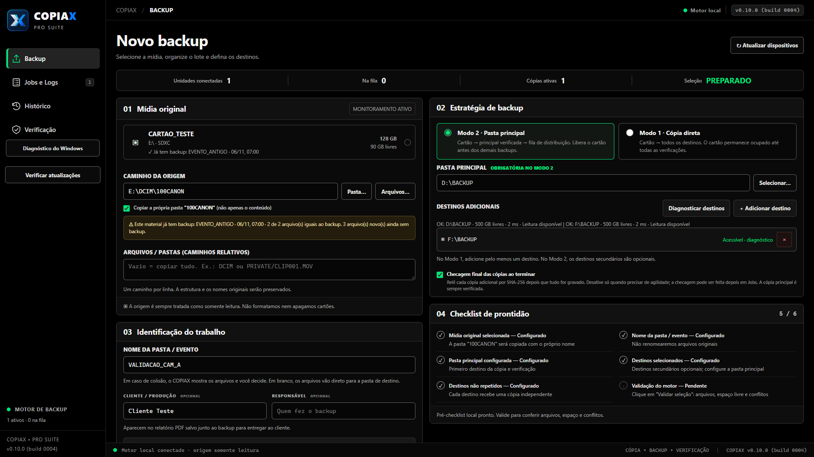
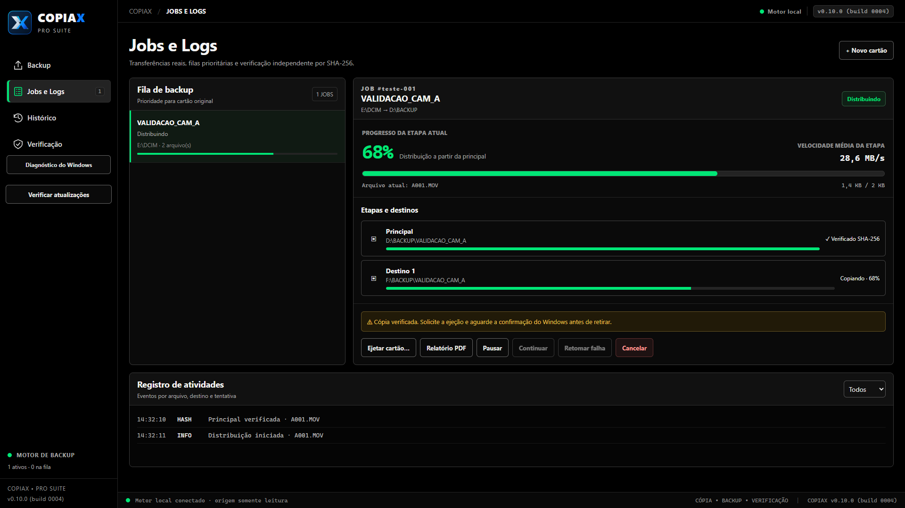
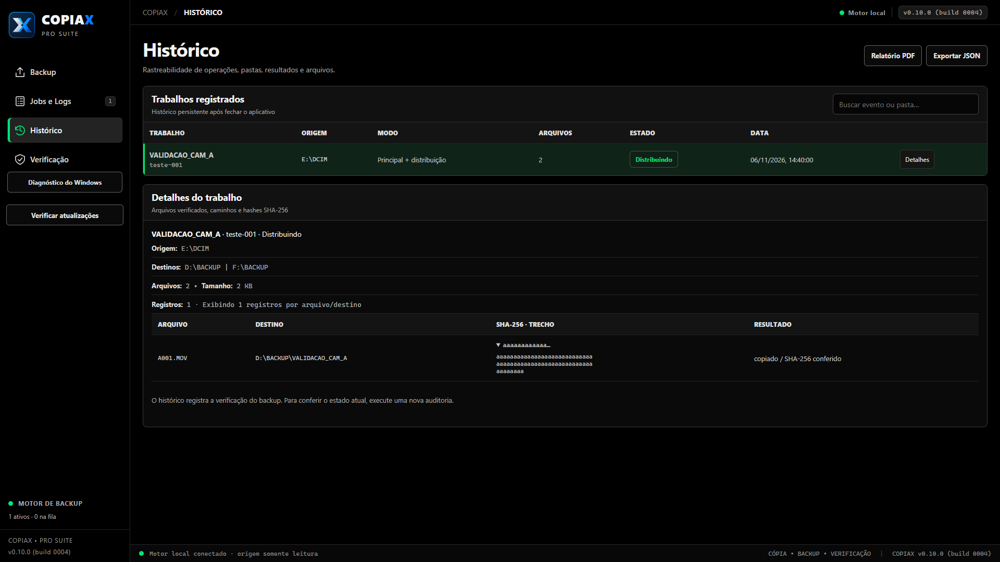
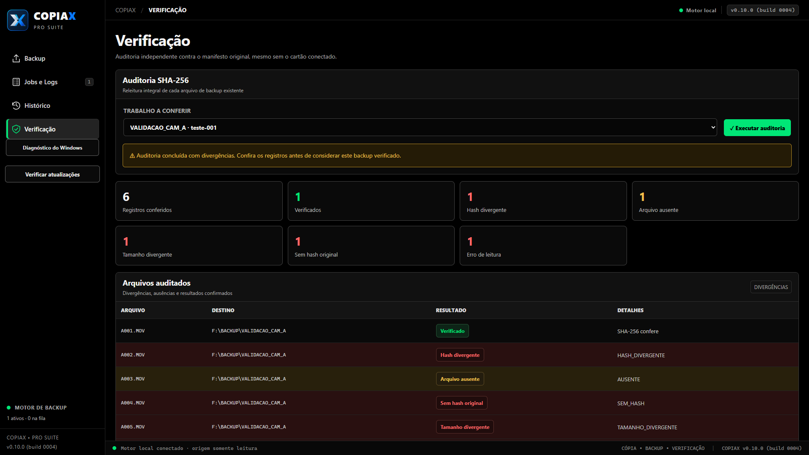

# COPIAX Pro Suite

**Cópia • Backup • Verificação**

Da mídia original aos seus destinos, cada arquivo sob controle. Software para Windows voltado a profissionais de fotografia, vídeo e produção audiovisual.

## Conheça o software

- Cópia para múltiplos destinos e distribuição a partir de uma pasta principal.
- Verificação de integridade por SHA-256, com distinção entre cópia e verificação.
- Fila de trabalhos, progresso por destino, histórico, logs e relatórios.
- Operação local: suas mídias permanecem nos caminhos que você escolher.

**[Conheça o site oficial →](https://copiax.pages.dev/)**

## Telas do software

Capturas da interface **v0.10.0**, com **dados demonstrativos de teste**. A versão disponível para download pode apresentar ajustes. Clique nas imagens para ampliar.

### Backup

Seleção da origem, estratégia e destinos.

### Jobs e Logs

Progresso por destino e eventos de verificação.

### Histórico

Consulta de trabalhos, arquivos e resultados registrados.

### Verificação

Exemplo demonstrativo de auditoria com divergências e arquivos ausentes.

## Downloads para Windows

**[Baixar no site oficial](https://copiax.pages.dev/#downloads)** — instalador, executável e portable.

**[Versão mais recente no GitHub](https://github.com/samirbridi/copiax-pro-suite/releases/latest)** · **[Todas as versões](https://github.com/samirbridi/copiax-pro-suite/releases)**

Nos Releases, baixe os arquivos anexados: instalador `Setup.exe`, executável `COPIAX.exe` ou pacote `Portable.zip`. Os links automáticos “Source code” do GitHub contêm apenas esta apresentação, não o aplicativo.

Confira os arquivos usando o `SHA256SUMS.txt` do mesmo release. O manifesto de atualização também está disponível nos anexos.

### Requisitos e cuidados

Windows 10/11 de 64 bits e Microsoft Edge WebView2 Runtime. Extraia o ZIP portable antes de executar e use uma pasta com permissão de gravação.

Teste o fluxo com arquivos descartáveis ou já duplicados antes de utilizar em produção. SHA-256 confere igualdade dos dados lidos; não prevê falhas futuras do dispositivo. Mantenha cópias independentes e aguarde a confirmação de ejeção antes de remover a mídia.

## Sobre este repositório

Este é o canal público de apresentação e distribuição de versões compiladas do COPIAX Pro Suite. **Não é um projeto open-source e não distribui código-fonte do aplicativo.**

COPIAX Pro Suite é software proprietário. A disponibilidade para download não concede uma licença open-source sobre o software ou a marca. Aplicam-se os termos fornecidos pelo titular e as licenças das respectivas dependências de terceiros.
